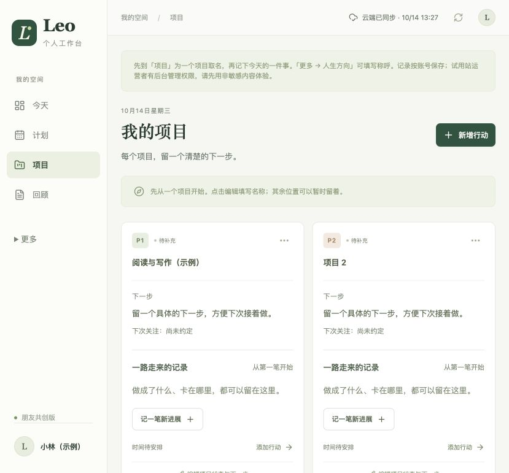

# Leo 个人工作台 · 开源共创

把重要的事，向前推进一点。一个从真实日常使用中迭代的个人行动与复盘工具。

**2026-10-14：桌面测试版。** [选择 Windows / Mac 下载](docs/download.md)，无需安装 Node.js，无需登录，记录留在自己的电脑。Mac Apple 芯片实测；Windows / Intel Mac 待实机验证。未办理签名/公证，先小范围试用。原源码启动方式继续保留。

[下载桌面版](docs/download.md) · [源码启动指南](docs/local-start.md) · [隐私检查](docs/privacy-check.md) · [查看源码](community/README.md) · [参加朋友试用](docs/community-pilot.md) · [反馈问题](https://github.com/mantoumessi-spec/leo-life-workbench/issues) · [贡献指南](CONTRIBUTING.md) · [更新记录](CHANGELOG.md)



*本地测试预览，非已开放的线上试用站。*

## 它能帮你做什么

- 今天的重要事项、08:00—22:00 的计划与实际并排记录，连续时段可合并。
- 按项目归类时间，区分投资、消费和负债。
- 项目进展按日期连续积累，未完成事项可继续安排、完成或关闭。
- 小结可以全屏写作，有效输入自动保存，网络失败和冲突会提示。
- JSON 备份/恢复、Markdown 导出、每周回顾；AI 草稿需确认后才写入。

新用户没有作者的业务和日记数据。各自使用自己的工作台，共同迭代代码；不提供群内共享项目。

## 当前状态

| 项目 | 状态 |
| --- | --- |
| 通用应用源码 | `community/`，MIT 开源，含本地运行步骤 |
| 个人原型 | 作者继续使用，未开放给他人 |
| 朋友版在线试用 | 暂不推进，先验证本地使用体验 |
| 本地验证 | 77 项单元测试、类型检查、构建通过；双模拟身份隔离/草稿越权/备份恢复检查通过 |
| AI 接入 | 保留草稿与 MCP 实现；线上连接需另行配置和真实账号验证 |
| 钉钉 | 朋友版前后端关闭，不复用公司应用 |

本地运行使用本机数据库和模拟身份，无需真实 ChatGPT 登录。未来云端托管才依赖 Sites 登录和 D1 存储，并非下载代码后自动获得免费云服务。网站不另外调用收费 AI API，现有 AI 产品和托管仍有各自额度。本地记录由自己的电脑保存，不提供本地密码保护；共享电脑建议使用独立系统账号。默认上海时区，六个可改名项目位置，小结上限 2000 字。

## 开发者快速开始

```sh
git clone https://github.com/mantoumessi-spec/leo-life-workbench.git
cd leo-life-workbench/community
npm ci
npm run db:local
npm run dev
```

需要 Node.js 22.13+。打开终端打印的 localhost 地址，本地使用模拟登录。**不要将开发服务器直接暴露到公网。** 托管、验证、功能边界见 [源码说明](community/README.md)。

## 一起迭代

先邀请几位朋友用两周，关注三个问题：哪里看不懂、哪里不好用、哪里真的帮到了你。反馈不需要附个人记录或数据备份。

- [这次为什么开放源码](docs/build-log/2026-10-14-community-edition.md)
- [项目进展时间线](docs/build-log/2026-10-09-project-continuity.md)
- [之前的私人原型介绍](docs/private-prototype-overview.md)

本项目代码按 [MIT](LICENSE) 开源，第三方代码保留原许可证。保护隐私的方法见 [SECURITY.md](SECURITY.md)。
