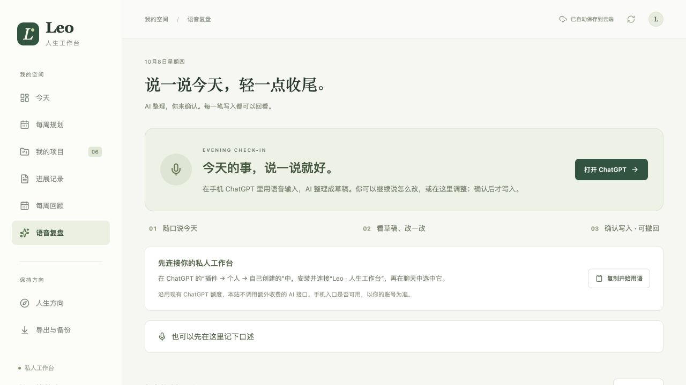

# 晚上很累，还要自己填复盘吗？

> 记录日期：2026-10-08（Asia/Shanghai）
> 阶段：私人原型迭代；云端插件读取已验证，手机完整使用流程待实测。
> [返回项目首页](../../README.md)

这个工作台最开始，是想把我每天使用的 Google 表格变得更顺手。

表格能用，也很直观。但当待办涉及多个项目，我又想同时看计划、实际投入和当天感受时，维护记录本身开始占用精力。尤其到了晚上，已经累了，还要重新整理一天做过的事。

今天我提出了一个更具体的需求：

> 我只想对着手机说说今天做了什么、有什么感受。AI 能不能先帮我整理，我调整、确认之后，再写入工作台？

## 先让 AI 整理，再由我决定

这次做出的流程是：读取当天已有记录 → 整理草稿 → 查看或修改 → 明确确认 → 正式写入。

草稿可以包含时间块、所属项目、时间类型、当天小结和下一步想法。时间不确定的经历单独保留；AI 提出的想法默认不加入待办。

我想保留的一点是：感受不必被“优化”成一段漂亮的总结。当天怎么说，就尽量保留自己的声音。

## 为什么需要一个草稿层

口述通常是不完整的。可能先说下午的事，再补上午；也可能只说“开了很久的会”，却没有准确时间。

如果 AI 一边听一边直接填正式记录，就容易把推测写成事实，或重复覆盖白天已经填过的内容。因此草稿先单独保存，确认前展示原内容与将要写入的内容。修改草稿以后，需要重新确认最新版本。

下一步建议也一样。“明天也许可以做”不等于我已经决定把它加入待办。

## 写入之后，还要能回头

这次同时做了重复确认保护和撤回：

- 同一次确认重复提交，不重复创建记录。
- 草稿生成后，如果相关正式记录已变化，先提示核对。
- 撤回会检查本次写入之后的修改；后来改过的内容不会被旧草稿覆盖。
- 原始口述、写入前后的对照继续保留，便于回看。

接口验证时发现过一个问题：新增待办经过保存和读取后，程序会误判它“后来被改过”，导致撤回失败。定位后发现比较方式过度依赖字段顺序，修正比较逻辑并补充回归测试，才通过完整的本地写入和撤回检查。

这提醒我，按钮做出来只是开始；真正使用时，重复点击、网络重试和后续修改都要考虑。

## 今天验证到哪一步

| 环节 | 结果 |
| --- | --- |
| 自动化测试 | 当前私人应用版本共 45 项通过 |
| 本地接口 | 草稿隔离、版本冲突、重复确认、并发确认、撤回和后续修改保护已验证 |
| 页面体验 | 桌面与手机宽度检查；草稿编辑、自动保存、确认与撤回已在本机浏览器验证 |
| 线上网站 | 已部署并检查页面 |
| 云端插件 | 已在当前桌面对话中读到已有记录 |
| 手机真实复盘 | 还没有完成口述到正式保存的完整实测 |

这里没有把“插件能读取”当作“手机整条流程已验证”。公开之后，我想继续记录剩下的使用过程，包括失败和需要手动纠正的地方。

*截图摄于首次连接前，画面不含个人行动记录；随后完成了桌面对话中的云端读取验证。*

## 这次采用的方式与限制

AI 整理使用已有 ChatGPT，工作台通过私人云端插件提供读取、草稿、确认和撤回操作。网站本身没有新增收费 AI API。

这也带来了上手门槛：用户需要能在自己的账号中使用并连接插件。“我自己能连通”仍不能证明陌生用户也能顺利上手。现阶段没有承诺免费托管、所有账号可用或面向公众的安装版本。

工作台已保存的数据在云端，但它不会自动写回电脑里的本地日记文件。

## 下一次值得记录的事

我准备先完成一次真实的手机复盘，观察三个问题：

1. 我说完之后，需要改多少内容？
2. AI 是否能保留不确定信息，而不是补造时间或决定？
3. 从开始口述到确认保存，究竟减少了多少整理负担？

暂时没有可靠的节省时间数据，也还没有外部用户留存或付费验证。先把一次真实使用记清楚，再决定下一步。

---

由 Leo 提出需求、作出产品取舍并验收体验，AI 协助实现、测试和整理本文。示例表述已泛化，不包含具体业务数据。
