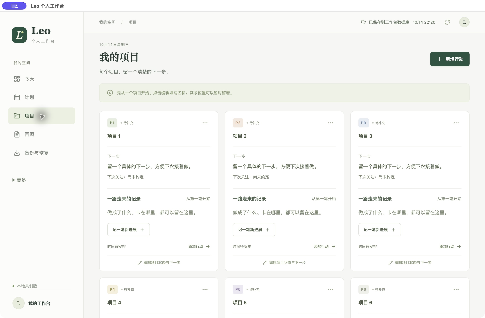

# 下载个人工作台

把重要的事，向前推进一点。**无需安装 Node.js，无需登录。** 下载后在自己的电脑使用，记录保存在本机。

这是 **0.2.0 小范围测试版**。先用几条测试记录试用，确认保存、重启和备份正常后，再记录重要内容。

| 你的电脑 | 选择下载 | 验证情况 |
| --- | --- | --- |
| Windows（常见 Intel / AMD 64 位电脑） | [下载 Windows 版](https://github.com/mantoumessi-spec/leo-life-workbench/releases/download/v0.2.0-preview.1/Leo-Workbench-0.2.0-Windows-x64.zip) | 已打包、内容检查通过；待 Windows 实机验证 |
| Mac（M1 / M2 / M3 / M4 等 Apple 芯片） | [下载 Mac Apple 芯片版](https://github.com/mantoumessi-spec/leo-life-workbench/releases/download/v0.2.0-preview.1/Leo-Workbench-0.2.0-Mac-Apple.zip) | 本机打开、保存、重启、导出已验证 |
| Mac（Intel 芯片） | [下载 Mac Intel 版](https://github.com/mantoumessi-spec/leo-life-workbench/releases/download/v0.2.0-preview.1/Leo-Workbench-0.2.0-Mac-Intel.zip) | 已打包、内容检查通过；待 Intel Mac 实机验证 |

Mac 不确定选哪个：左上角苹果菜单 → 关于本机，看“芯片”或“处理器”。Windows ARM 电脑暂未验证。

## 打开就能用

- **Windows**：完整解压 ZIP，打开里面的 `LeoWorkbench.exe`。不要只拖出 exe，也不要在压缩包里运行。
- **Mac**：解压 ZIP，将 `Leo Workbench.app` 放入“应用程序”，然后打开。
- 到“项目”为一个项目取名，先记下一件事。输入后等待顶部显示“已保存到工作台数据库”。

这是免开发环境的压缩包，不是商店安装包。当前未办理开发者签名/公证，系统可能拦截或警告；遇到时保留提示反馈，不要关闭安全软件或运行绕过安全检查的命令。未验证所有操作系统版本，也未验证另一台 Mac 从互联网下载后的首次打开流程。

## 我的信息在哪里？

记录、草稿和自动备份在**自己的系统用户数据目录**，与程序分开；更换软件版本不替换数据目录。软件菜单 **文件 → 打开数据和备份文件夹** 可以找到。

- Mac：`~/Library/Application Support/Leo Workbench/`
- Windows：`%APPDATA%/Leo Workbench/`
- `workbench.sqlite` 保存记录；`backups/` 保留每天首次启动时的数据库副本。首次启动空库时，首份副本也为空。软件整天不关闭时不会定时生成新副本。
- 页面“备份与恢复”下载 JSON，可恢复普通记录；复盘草稿另行导出。建议另存一份到独立磁盘，防止电脑故障。自动副本不自动清理，请按需转存。

软件没有联网同步、遥测、自动更新或内置付费 AI。程序内部页面和保存接口由桌面进程处理，不开放本地网络服务。点击“打开 ChatGPT / 反馈与共创”时才会主动打开外部浏览器；复制到 AI 的内容由你自己决定。系统云盘或备份软件也可能另行同步你的文件。

本地数据没有额外密码或加密；共用电脑请使用独立的系统账号。关闭电脑后不能在手机继续使用同一份数据。

## 升级和反馈

升级前先导出备份，退出旧版，再替换应用程序。**不要删除数据目录。** 源码启动版与桌面版不是同一个数据目录；普通记录可用 JSON 导出/恢复迁移，复盘草稿没有一键迁移入口。

[反馈问题](https://github.com/mantoumessi-spec/leo-life-workbench/issues) · [查看源代码](../community/desktop/README.md) · [隐私检查说明](privacy-check.md) · [全部下载与校验文件](https://github.com/mantoumessi-spec/leo-life-workbench/releases/tag/v0.2.0-preview.1)

反馈请只附操作步骤与错误提示，遮住个人内容，不要上传数据库或完整备份。
