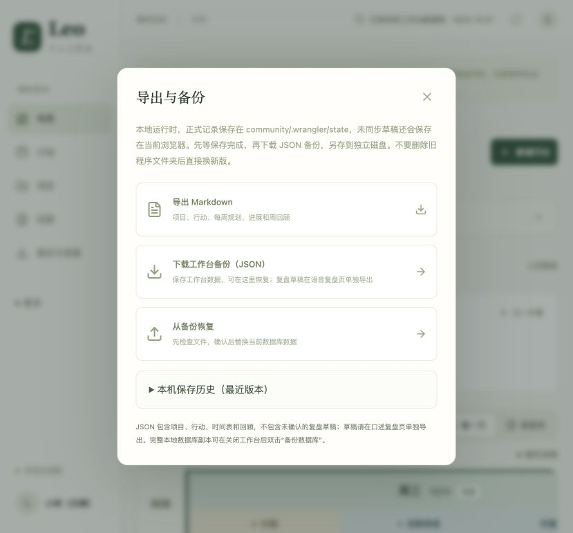

# 旧版源码启动说明（保留供开发者参考）

**新版群友请直接使用 [Windows / Mac 下载入口](download.md)，无需以下安装步骤。** 本文是 0.2 版本的历史启动方式，未适配新版 Markdown 文件接口，不是 0.3 试用入口。

这是本地试用版，不需要付费 AI 接口，也不需要登录 ChatGPT 才能记事。首次安装需要联网；数据保存在你的电脑。Mac 已在开发机验证；Windows 启动文件已提供，尚需 Windows 实机首测。

## 第一次准备

1. 从 [Node.js 官网](https://nodejs.org/en/download) 安装 **Node.js 24 LTS**，按默认选项安装即可。只从官方入口下载。
2. 打开 [项目首页](https://github.com/mantoumessi-spec/leo-life-workbench)，点绿色 **Code → Download ZIP**。
3. **完整解压**，把整个文件夹放在一个固定位置，例如“文档/Leo工作台”。不要只取出启动文件，不要直接在压缩包里运行。尽量放在不自动同步的本地文件夹；若放进 iCloud、OneDrive 等目录，系统可能将数据库同步到这些服务。
4. 进入 `community → launcher`，选择自己电脑对应的文件。

| 操作 | Windows | Mac |
| --- | --- | --- |
| 第一次安装 | 双击 `首次安装-Windows.cmd` | 双击 `首次安装-Mac.command` |
| 日常打开 | 双击 `启动工作台-Windows.cmd` | 双击 `启动工作台-Mac.command` |
| 完整数据库备份（先停止工作台） | 双击 `备份数据库（先关闭工作台）-Windows.cmd` | 双击 `备份数据库（先关闭工作台）-Mac.command` |

安装窗口会下载依赖并准备本地数据库，可能需要几分钟。看到“安装完成”后再启动。安装失败会保留提示，不会重置你的数据库；检查网络及磁盘空间后重试。建议留出至少 3GB 空间。

Mac 如果解压后 `.command` 不能双击执行，可打开“终端”，输入 `bash `（末尾留空格），把对应 `.command` 文件拖进去，按回车。无需关闭系统安全功能或使用管理员权限。若系统或浏览器显示安全拦截，不要绕过，先把提示发给维护者核对。

## 每天怎么用

- 双击“启动工作台”，等浏览器自动打开。没自动打开时，手动访问 **http://127.0.0.1:5173**。
- 保留启动窗口。网页只是操作界面，窗口里的本地程序负责读写数据库。
- 首次登录只是本地模拟身份，不会跳到真实 ChatGPT 认证，也不是密码保护。能使用你的电脑的人可能查看你的本地记录，请用自己的电脑/系统账号。
- 到“项目”修改项目名称；先用一个项目就好。填写当天安排、小结，等待“已保存到工作台数据库”。
- 退出时先确认保存完成，再到启动窗口按 **Ctrl+C**。电脑关机后不能从手机继续访问；没有跨设备自动同步。

## 数据在哪里

| 内容 | 保存位置 |
| --- | --- |
| 项目、行动、时间表、日记小结、复盘草稿等已保存记录 | 程序文件夹 `community/.wrangler/state` |
| 尚未提交的输入、近期保存副本 | 当前浏览器本地存储 |
| 启动前的数据库副本、双击备份生成的副本 | `community/.local-backups/日期时间/` |
| 页面下载的 JSON / Markdown | 浏览器选择的下载目录 |

`.wrangler` 和 `.local-backups` 是隐藏文件夹。Mac 可用 Command+Shift+. 显示隐藏文件；Windows 在资源管理器中开启“隐藏的项目”。它们被 Git 忽略，不会随正常源码提交上传，但打包整个文件夹发给别人会泄露数据。**只向朋友分享 GitHub 链接，不要分享用过的程序目录。**

工作台不会自动上传这些记录到作者或 GitHub；主动复制给 ChatGPT 等云端 AI、使用系统同步盘或另行上传备份时，相关内容会离开电脑。

## 备份与恢复

### 日常推荐：页面导出

1. 页面侧栏点击 **备份与恢复**，等待保存完成。
2. 点 **下载工作台备份（JSON）**，把文件另存到移动硬盘等独立位置。
3. JSON 包含项目、行动、时间表和周回顾；未确认的复盘草稿请到口述复盘页另外导出。草稿导出用于留存原文，目前没有一键重新导入草稿的入口。
4. 恢复普通记录：在目标工作台点 **备份与恢复 → 从备份恢复**，选择 JSON，核对后确认。系统会先下载恢复前副本；请允许下载并保管好。恢复会替换该工作台当前的普通记录。

### 完整副本：保留全部数据库记录

1. 确认网页保存完成，按 Ctrl+C 停止工作台。
2. 双击“备份数据库”，把窗口显示的副本目录复制到独立位置。
3. 完整副本包括数据库中所有本地测试身份的记录，不包含尚未保存的浏览器草稿。
4. 恢复时保持程序关闭：先将目标 `community/.wrangler/state` 改名为 `state-before-restore` 留底（同名已存在时另取名字），再把副本中的 `state` 文件夹复制到 `community/.wrangler/state`。不要覆盖或删掉留底副本。重新启动核对；若浏览器提示旧草稿冲突，先导出核对，不要直接覆盖数据库。

程序不会自动删除旧副本。请定期把需要保留的副本转存到独立磁盘，再自行清理过旧的副本，避免长期占用空间。

## 更新版本

先备份，再更新。不要删掉旧文件夹、覆盖 `.wrangler` 或清理浏览器缓存。不会用 Git 的朋友：解压新版到新位置，在旧程序关闭的情况下，按上面的完整副本步骤迁移 `state`，然后运行新版“首次安装”。不同电脑须重新安装依赖，不复制 `node_modules`。旧文件夹保留到核对所有记录都在之后。

## 遇到问题

- 找不到 Node：装好后重新打开启动文件；仍失败时重开终端。
- 5173 被占用：先检查是否已开了一个工作台窗口。不会自动跳到 5174，避免浏览器草稿换地址后看起来消失。
- 提示启动锁：先确认所有工作台窗口已经停止，再删除 `community/.sites-runtime/launcher.lock`；不要在运行中删除。
- 保存失败：保留输入，先复制文字或导出待保存内容，不要反复刷新。
- 发反馈时只截错误提示，遮住日记、项目内容和本机路径。不要上传数据库或完整备份。
